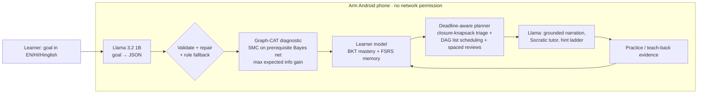
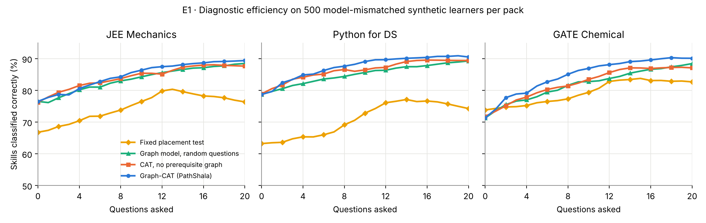
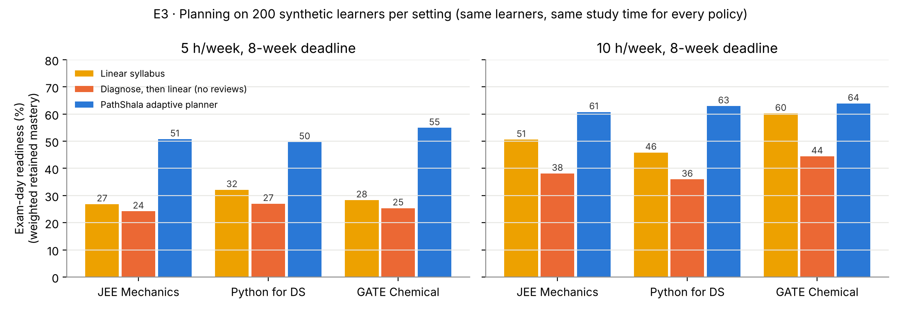

# PathShala — पथशाला
> **Demo video (2 min):** https://youtu.be/uMShBU5a4UA · **Technical report:** [docs/PathShala_Technical_Report.pdf](docs/PathShala_Technical_Report.pdf)

### An on-device, neuro-symbolic personalised learning companion for Arm Android phones
**Arm Bharat AI-SoC Challenge 2026-27 · Problem Statement 4: On-device personalised learning assistant**
Team: Jash Bharat Pasad · Chaitanya Bhoite · Harsh Kumar Jha — IIT Gandhinagar · Faculty mentor: Prof. Joycee

> *Path* (the learning path) + *Pathshala* (school). A personal learning path that lives in your pocket. It is private, works offline, and adapts every day.

---

## The idea in one paragraph
A 1-billion-parameter model on a phone can parse language and explain things well. It cannot reliably decide what a student doesn't know or how to schedule eight weeks of study. So PathShala splits the job.
- **Llama 3.2 (ExecuTorch, Arm CPU)** handles language in and language out: it understands goals written in English, Hindi or Hinglish, explains the plan, tutors Socratically, gives hints and grades "teach-back" explanations.
- **A symbolic learning engine** makes the decisions. It diagnoses skill gaps with Bayesian adaptive testing on a prerequisite graph, tracks knowledge and forgetting (BKT + FSRS), and builds a deadline-aware study plan that it re-optimises after every answer.

Every LLM output is validated, with a deterministic fallback, so a bad generation can lower quality but cannot break the app. The APK requests **zero Android permissions, including no INTERNET**, so privacy is enforced by the OS rather than promised.



## What's in this repository
| Path | What it is |
|---|---|
| `core/` | **Pure-Kotlin learning engine** (no Android deps): `GraphDiagnostic` (Graph-CAT), `LearnerModel` (BKT), `Fsrs` (FSRS-4.5), `Planner`, `SkillGraph`, Llama prompt library + output parsers, curated skill packs, 16 unit tests, evaluation simulator |
| `app/` | **Android app** (Kotlin + Jetpack Compose): ExecuTorch `LlmModule` integration, Arm device profiling, thermal-aware generation, 7 screens |
| `core/src/main/resources/packs/` | 3 curated skill graphs (36 skills, 72 calibrated MCQs): **JEE Main Mechanics**, **Python for Data Science**, **GATE Chemical Engineering** |
| `tools/build_packs.py` | Human-readable pack authoring source → JSON |
| `model/` | Llama 3.2 → `.pte` export script (ExecuTorch 1.5.1, SpinQuant, XNNPACK, ctx 2048) and phone push script |
| `eval/` | Results CSVs, figures and `RESULTS.md` from the synthetic-learner study |
| `docs/` | Technical report (PDF), 2-minute demo script, `video/make_demo.sh` (portrait phone recording → 1080p 16:9 MP4 with title, fact panel and captions) |
| `SUBMISSION_CHECKLIST.md` | Everything to do before the one-shot submission form |

## Quick start
```bash
# 1) Build and test (JDK 17+, Android SDK 35)
./gradlew :core:test            # 16 engine tests
./gradlew :app:assembleDebug     # -> app/build/outputs/apk/debug/app-debug.apk
adb install -r app/build/outputs/apk/debug/app-debug.apk

# 2) Put Llama on the phone (see model/README.md)
./model/export_llama.sh
./model/push_to_phone.sh ~/pathshala-model/llama3_2_1b_spinquant_ctx2048.pte ~/pathshala-model/tokenizer.model
#    In the app: Engine → Scan & load. Without a model the app runs in clearly-labelled "template mode".

# 3) Reproduce the evaluation (≈2 min on a laptop)
./gradlew :core:run --args="$PWD/eval/results 500 200" && python3 eval/plot_results.py
```

## Key results (synthetic learners, model-mismatched; see `eval/RESULTS.md`)
| | JEE Mech. | Python DS | GATE CH |
|---|---|---|---|
| Diagnostic accuracy, fixed 12-question test | 79.8% | 76.1% | 82.8% |
| Diagnostic accuracy, **Graph-CAT at 12 questions** | **87.5%** | **89.7%** | **88.1%** |
| Questions Graph-CAT needs to match the fixed test | 4 | 0* | 7 |
| Exam readiness at 5 h/wk × 8 wk, linear syllabus → **PathShala** | 26.8% → **50.8%** | 32.1% → **49.7%** | 28.3% → **54.9%** |
| Exam readiness at 10 h/wk × 8 wk, linear syllabus → **PathShala** | 50.6% → **60.8%** | 45.9% → **62.9%** | 60.2% → **63.9%** |

\*On Python, the depth-calibrated prior plus the self-reported level already scores 78.7% before any question.




## Honest limitations (Phase 2 targets)
Results come from simulated learners, not people; a pilot with ~30 IITGN students is planned. Skill packs are hand-curated, and roadmaps for goals outside the packs are drafted by Llama and marked *unverified*. Hindi quality at 1B is modest; 3B is offered on 12 GB+ phones. On-device latency, CPU use (cores busy), threads, memory and battery power are measured in-app on the team's phone (Engine → benchmark, also logged to `adb logcat -s PathShala/Bench`), and we don't claim anything we haven't measured.

## Licences
Code: MIT (see `LICENSE`). Llama 3.2 is used under the Llama 3.2 Community License. Model weights are **not** redistributed in this repo.
