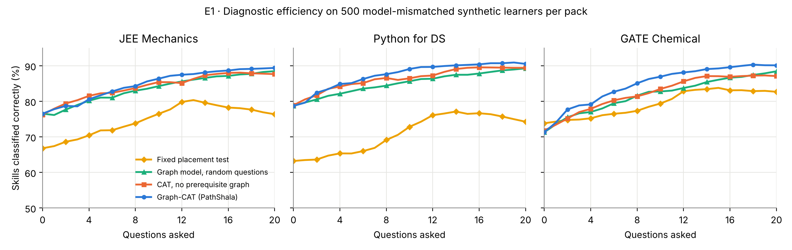
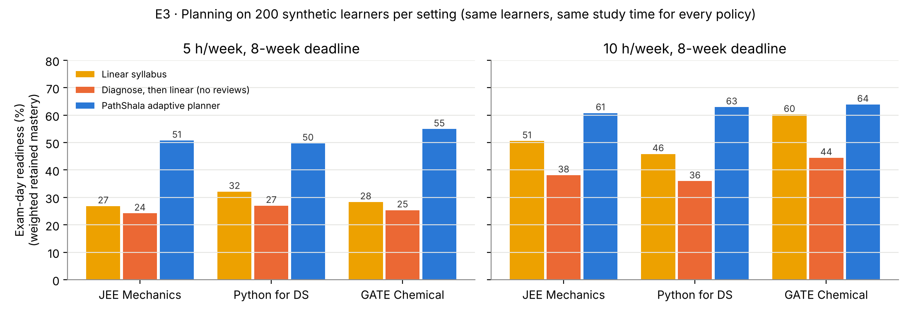

# Evaluation results (auto-generated by eval/plot_results.py)

## E1 Diagnostic efficiency

| Pack | Fixed test @12 q | Graph-CAT prior only (0 q) | Graph-CAT @6 q | Graph-CAT @12 q | Q for Graph-CAT to match fixed@12 | Brier @12 (Graph-CAT / fixed) |
|---|---|---|---|---|---|---|
| JEE Mechanics | 79.8% | 76.5% | 82.8% | 87.5% | 4 (67% fewer) | 0.097 / 0.202 |
| Python for DS | 76.1% | 78.7% | 86.3% | 89.7% | 0 (100% fewer) | 0.081 / 0.239 |
| GATE Chemical | 82.8% | 71.3% | 82.7% | 88.1% | 7 (42% fewer) | 0.097 / 0.172 |



## E2 Self-stopping Graph-CAT (max 12 questions)

```
pack=jee_mechanics learners=500 avg_questions=9.87 accuracy_at_stop=0.8765
pack=python_ds learners=500 avg_questions=10.81 accuracy_at_stop=0.8977
pack=gate_cheme learners=500 avg_questions=11.46 accuracy_at_stop=0.8818
```

## E3 Planning

| Pack | Budget | Linear syllabus | Diagnose + linear | PathShala | Gain vs linear | Re-studied known material (linear → PathShala) |
|---|---|---|---|---|---|---|
| JEE Mechanics | 5 h/wk | 26.8% | 24.2% | 50.8% | +89% | 49% → 30% |
| Python for DS | 5 h/wk | 32.1% | 27.0% | 49.7% | +55% | 54% → 26% |
| GATE Chemical | 5 h/wk | 28.3% | 25.4% | 54.9% | +94% | 64% → 36% |
| JEE Mechanics | 10 h/wk | 50.6% | 38.1% | 60.8% | +20% | 34% → 24% |
| Python for DS | 10 h/wk | 45.9% | 35.9% | 62.9% | +37% | 32% → 22% |
| GATE Chemical | 10 h/wk | 60.2% | 44.5% | 63.9% | +6% | 51% → 34% |


